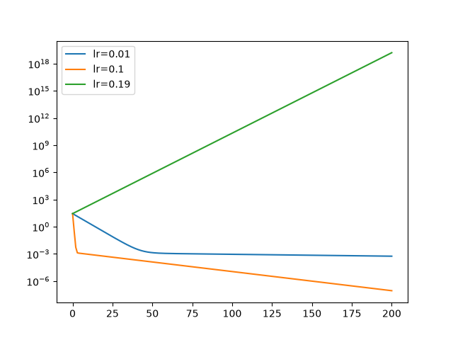

# hello-uv: Milestone 1, Numpy from scratch

## How to run
run `uv sync` to download necessary dependencies
- imgetools.py: `uv run src/hello_uv/check_imagetools.py`
- linreg.py: `uv run src/hello_uv/check_linreg.py`
- gd.py: `uv run src/hello_uv/check_gd.py`
- run `uv run src/hello_uv/loss_curve.py` to get losses_curve.png
## 1. imagetools.py: image transforms
- ```def invert(img)```
- ```def adjust_contrast(img,factor)```
- ```def shift(img,dx,dy)``` 
- ```def rotate(img,angle)``` takes in an image and rotates the image by a given angle
## 2. linreg.py: MSE loss and its gradient
- ```def predict(w,b,x)``` predict y given the weight,baise and x
- ```def mse(w,b,x,y)``` gets the prediction from ```predict()``` and subtracts it from the true y, and squares it, giving us the squared error, then we take the mean of the point. 
- ```gradient(w,b,x,y)``` calculates the residual  then calculates the mean using the partial derivative of w and b
- ```numeric_gradient(w,b,x,y,h)``` central difference
## 3. gd.py: gradient descent
- ```step(w,b,x,y,lr)``` gets the pratial derevative of w and b then calculate the new w and b after the step
- ```descend(w,b,x,y,lr,steps)``` calculates the losses of the steps

## 4: torchgrad.py: autograd check

- ``` w = torch.tensor(w,requires_grad=True, dtype=torch.float64),  b = torch.tensor(b,requires_grad=True, dtype=torch.float64)``` changes w and b into tensors and tracks the number
- ``` x = torch.from_numpy(x), y = torch.from_numpy(y) ``` copies x,y from the numpy array and makes a tensor. if the tensor changes the array also changes
- ```  pred = predict(w,b,x), sqr_error = (pred - y)**2, L = sqr_error.mean() ``` calculates the prediction and the mean squared error

- ``` L.backward() ``` calculates the pratial derivatives of the tracked variables, in this case w and b

- ```  w_grad = w.grad, b_grad = b.grad ``` holds the partial derivatives of w and b calculated form ```L.backward()```

- ``` return w_grad.detach().item(),  b_grad.detach().item() ``` returns w and b as a list instead of a tensor


## results
|lr|Final loss| 
| -------- | ------- |
|0.01|0.00056|
| 0.1 | 8.625e-08| 
|0.19| 1.6e+19| 



